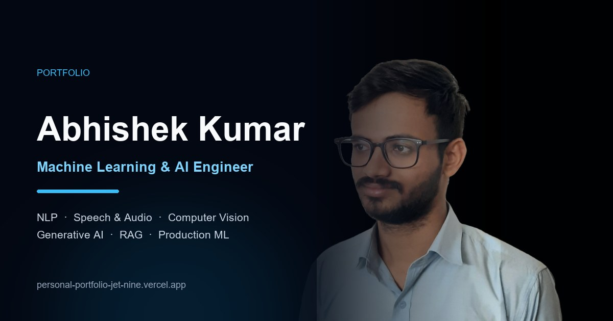

# Abhishek Kumar — Personal Portfolio

A fast, accessible, single-page portfolio for a Machine Learning & AI Engineer working across NLP, speech and audio, computer vision, and retrieval-augmented generation.

**Live site:** [personal-portfolio-jet-nine.vercel.app](https://personal-portfolio-jet-nine.vercel.app)



## Highlights

- Semantic, single-page layout with a clear heading hierarchy and section landmarks
- Responsive from 320 px phones through wide desktop screens
- Accessible tabs, mobile navigation, skip link, visible focus states, and reduced-motion support
- Project details that work with a mouse, keyboard, and touch — no hover-only content
- Contact form with validation, sending state, success feedback, and an email fallback if delivery fails
- Content remains readable when JavaScript is unavailable
- Self-hosted visual system: inline SVG icons, optimized WebP imagery, no icon libraries or animation frameworks
- SEO metadata, Open Graph/Twitter cards, JSON-LD `Person` schema, `robots.txt`, and `sitemap.xml`
- Security headers and asset caching configured in [`vercel.json`](vercel.json)

## Tech stack

- HTML5
- Modern CSS (custom properties, Grid, Flexbox, `clamp()`)
- Vanilla JavaScript (IntersectionObserver, accessible tabs, mobile drawer, contact form)
- Self-hosted Montserrat variable font (37 KB Latin subset)
- Vercel for static hosting
- Google Apps Script for contact-form delivery

No build step, package manager, or framework is required.

## Run locally

From the project folder, start any static file server. For example:

```bash
python -m http.server 8765
```

Then open [http://localhost:8765](http://localhost:8765).

Opening `index.html` directly also works for layout checks, but a local server is recommended so fonts, images, and the contact endpoint behave like production.

## Project structure

```text
.
├── index.html
├── style.css
├── script.js
├── images/
│   ├── Abhishek_Kumar_CV.pdf
│   ├── apple-touch-icon.png
│   ├── background.webp
│   ├── favicon.ico
│   ├── logo.webp
│   ├── mobile-bg.webp
│   └── og-cover.jpg
├── fonts/
│   └── montserrat-latin-variable.woff2
├── robots.txt
├── sitemap.xml
├── vercel.json
└── README.md
```

The original `background.png`, `Mobile_bg.png`, and `Logo.jpg` source images are kept in the repository for future edits and excluded from the deployment with [`.vercelignore`](.vercelignore).

## Contact form

The form posts to a Google Apps Script web app. The endpoint is defined once near the top of [`script.js`](script.js):

```js
var CONTACT_ENDPOINT = "https://script.google.com/macros/s/.../exec";
```

To use your own inbox, replace that URL with your Apps Script deployment. The form supports a honeypot field and displays a direct email fallback if the request fails.

## Deployment

The site is designed for Vercel:

1. Push the repository to GitHub.
2. Import the repository at [vercel.com/new](https://vercel.com/new).
3. Keep the framework preset as **Other** and leave the build command empty.
4. Deploy; Vercel serves the static files from the repository root.

Any static host works as well — the site has no server-side dependencies.

## Asset notes

- Hero images are WebP: about 26 KB desktop and 37 KB mobile.
- Montserrat is self-hosted as a 37 KB variable font, so no request is made to Google Fonts.
- Logo is a transparent WebP recolored to the site’s cyan/violet palette.
- Social preview is a 1200 × 630 JPEG at about 60 KB.
- Résumé is a compact two-page PDF at about 7 KB.

## License and content

The site content, résumé, and images belong to Abhishek Kumar. Please do not reuse the personal content without permission.
